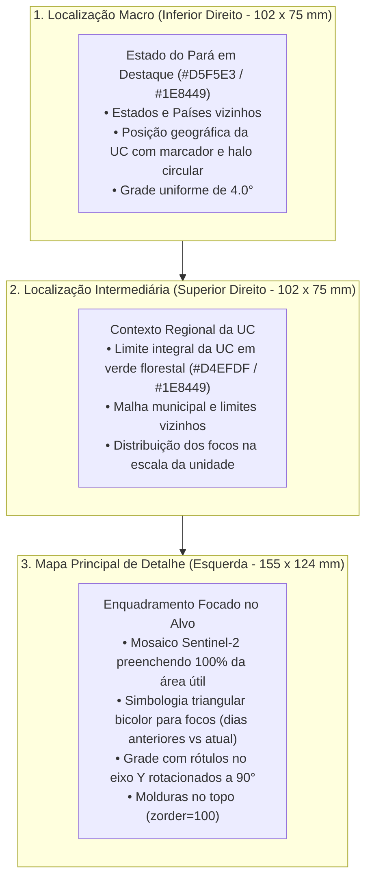

# Cartografia de Focos de Queimadas e Severidade em UCs do Pará

[](https://colab.research.google.com/github/NGEO-IDEFLOR-Bio/cartografia-queimadas-ucs-pa/blob/main/notebooks/colab_runner.ipynb)
[](https://www.python.org/downloads/)
[](https://earthengine.google.com/)
[](https://www.ibge.gov.br/)
[](https://ideflorbio.pa.gov.br/)

Pipeline automatizado em **Python, Google Earth Engine (GEE)** e **Google Colab** para detecção, monitoramento e mapeamento institucional de focos de queimada (**BDQueimadas/INPE**) e análise de severidade espectral (**Sentinel-2 Harmonized**) nas Unidades de Conservação (UCs) estaduais do Pará.

O projeto unifica a arquitetura modular e desacoplada de `cartografia-alertas-deter-pa` com o rigor cartográfico milimétrico de pranchas **A4 Paisagem (297 x 210 mm)** em 3 níveis hierárquicos do `qgis-layout-engine`.

---

## 1. Destaques e Funcionalidades

* **Execução em Nuvem (Google Colab):** Todo o pipeline pode ser executado de qualquer lugar, a qualquer hora, para qualquer UC, através de um notebook leve orquestrador (`notebooks/colab_runner.ipynb`) com autenticação interativa nativa do GEE.
* **Simbologia Padronizada dos Focos de Queimada:**
  - **Focos de Dias Anteriores:** Marcadores triangulares (`▲`) com preenchimento em amarelo vibrante (`#FAFF39`) e contorno bronze queimado (`#B35C15`).
  - **Focos do Dia Atual / Última Observação:** Marcadores triangulares (`▲`) com preenchimento em vermelho alerta (`#DB1E2A`) e contorno bordô escuro (`#801119`).
* **Três Variantes Cartográficas Automáticas:**
  1. **Falsa Cor (SWIR-NIR-Red: B12, B8, B4):** Realce máximo de frentes de fogo e cicatrizes recentes.
  2. **Cor Natural (RGB: B4, B3, B2):** Visão limpa de relevo e vegetação.
  3. **NBR (Normalized Burn Ratio):** Índice espectral normalizado $\frac{\text{B8} - \text{B12}}{\text{B8} + \text{B12}}$ mapeando severidade do fogo.
* **Cobertura Orbital de 100% da Área Visível:** O cálculo da extensão do mosaico Sentinel-2 expande e ajusta o *bounding box* ao *aspect ratio* exato do quadro do mapa principal ($155 \times 124\text{ mm}$), garantindo que a imagem preencha todo o viewport sem lacunas ou bordas pretas.
* **Pranchas em Alta Resolução (300 DPI):** Exportação direta em formato raster (PNG 300 DPI) para relatórios e vetorial (PDF) para anexação em processos administrativos (PAe/SEI).

---

## 2. Hierarquia Cartográfica em 3 Escalas

A prancha obedece à especificação oficial do **Núcleo de Geotecnologias (NGEO/IDEFLOR-Bio)**:



---

## 3. Estrutura do Repositório

```text
cartografia-queimadas-ucs-pa/
├── data/
│   ├── raw/                 # Dados brutos baixados (focos BDQueimadas, CSVs)
│   └── processed/           # Camadas oficiais (UCs Estaduais, Pará, Municípios, Brasil)
├── assets/
│   └── img/                 # Logomarcas oficiais (Brasão PA, IDEFLOR-Bio, NGEO)
├── src/
│   ├── __init__.py
│   ├── config.py            # CRS, cores hexadecimais, layout milimétrico e parâmetros orbitais
│   ├── gee_pipeline.py      # Autenticação GEE, máscaras Sentinel-2 e cálculo dinâmico de extensão
│   ├── bdqueimadas.py       # Ingestão de focos, filtro espacial por UC e segregação temporal
│   ├── layout_engine.py     # Motor de renderização A4 Paisagem (297x210 mm) em Python puro
│   └── exporter.py          # Gerador das 3 pranchas (Falsa Cor, Cor Natural, NBR) em PNG e PDF
├── notebooks/
│   └── colab_runner.ipynb   # Notebook orquestrador enxuto para execução no Google Colab
├── outputs/                 # Pranchas geradas em PNG 300 DPI e PDF
├── diretriz.md              # Diretrizes de projeto e regras técnicas de engenharia
├── layout_elements.json     # Medidas milimétricas dos elementos QGIS
├── requirements.txt         # Dependências do projeto
└── README.md                # Este documento
```

---

## 4. Guia Rápido de Execução

### Opção A: Execução no Google Colab (Recomendada)
1. Clique no botão [](https://colab.research.google.com/github/NGEO-IDEFLOR-Bio/cartografia-queimadas-ucs-pa/blob/main/notebooks/colab_runner.ipynb) para abrir o notebook diretamente no Google Colab.
2. Execute a célula de autenticação GEE (`ee.Authenticate()` / `ee.Initialize()`).
3. Escolha a Unidade de Conservação (ex: `APA Marajó`), o intervalo de datas e execute.
4. Visualize as 3 pranchas geradas diretamente no navegador e baixe os PDFs.

### Opção B: Execução Local em Python

```bash
# 1. Clonar o repositório
git clone https://github.com/samuel-ngeo/cartografia-queimadas-ucs-pa.git
cd cartografia-queimadas-ucs-pa

# 2. Criar e ativar ambiente virtual
python -m venv venv
# Windows:
.\venv\Scripts\activate
# Linux/Mac:
source venv/bin/activate

# 3. Instalar dependências
pip install -r requirements.txt

# 4. Executar via script Python
python -c "
from src.gee_pipeline import init_gee
from src.exporter import processar_e_exportar_todos_os_mapas

init_gee()
processar_e_exportar_todos_os_mapas(
    nome_uc='APA Marajó',
    data_inicio='2025-08-01',
    data_fim='2025-12-31',
    focos_source='projects/ee-samuelsantosambientalcourse/assets/bdqueimadas_2025-08-01_2025-12-31'
)
"
```

---

## 5. Convenção das Cores de Simbologia

| Elemento | Preenchimento (Fill) | Contorno (Stroke) | Geometria / Marker | Significado |
| :--- | :---: | :---: | :---: | :--- |
| **Focos Dias Anteriores** | `#FAFF39` | `#B35C15` | Triângulo `▲` (70 pt) | Acúmulo histórico de queimadas no período |
| **Focos Dia Atual / Última Obs.** | `#DB1E2A` | `#801119` | Triângulo `▲` (95 pt) | Frentes ativas de fogo / emergência recente |
| **Limite da UC** | Transparente | `#00FF66` / `#004D20` | Polígono contínuo | Limite homologado DGMUC/IDEFLOR-Bio |

---

## 6. Autoria e Licença

* **Desenvolvimento:** Núcleo de Geotecnologias (NGEO / IDEFLOR-Bio).
* **Datum e Projeção:** SIRGAS 2000 (EPSG:4674).
* **Licença:** MIT.
