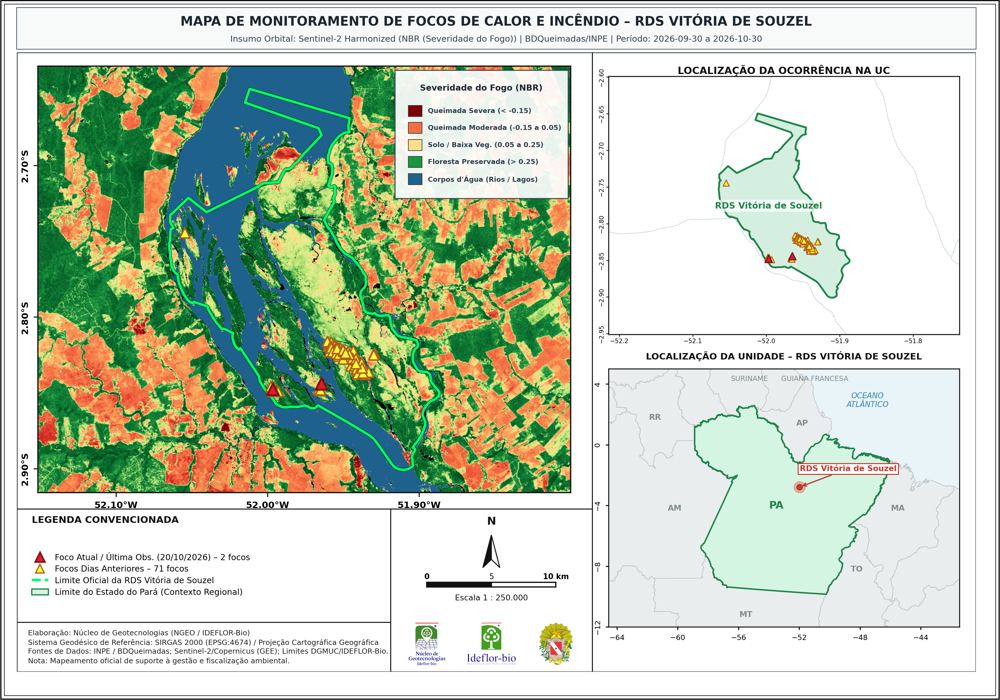
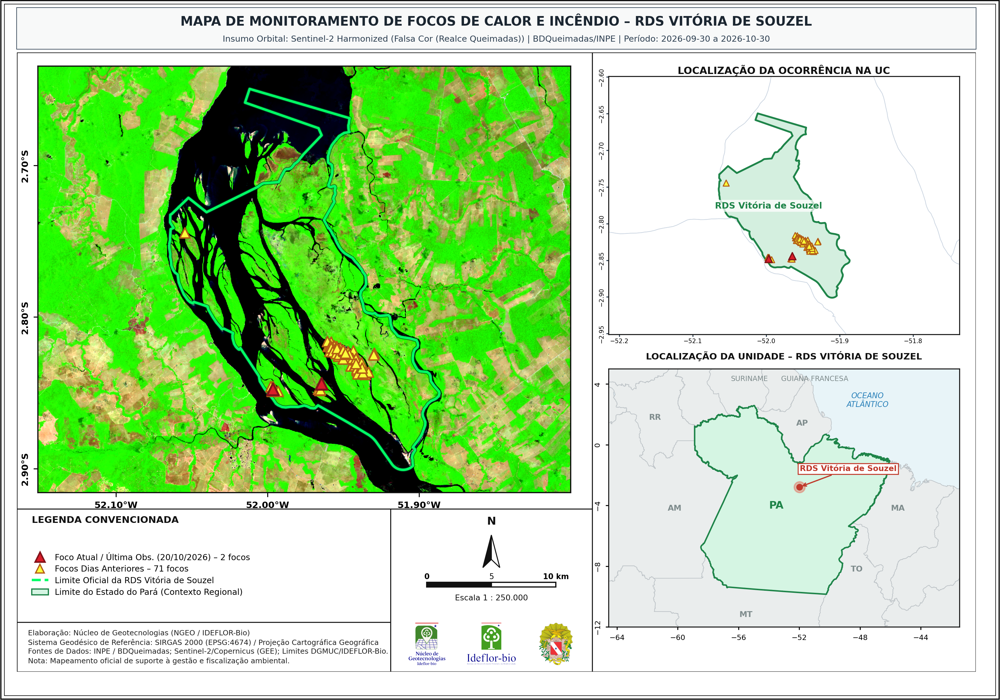
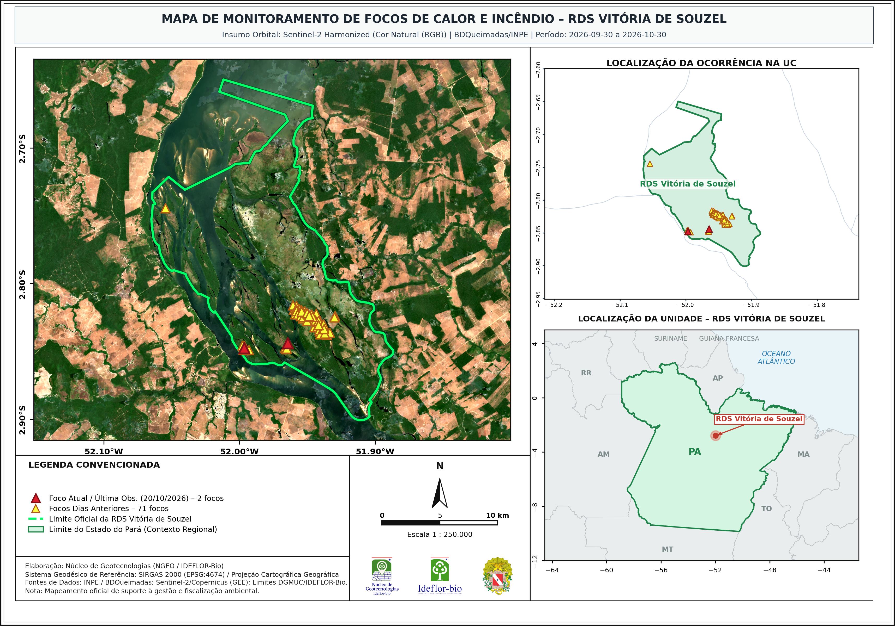

# Cartografia de Focos de Queimadas e Severidade em UCs do Pará

[](https://colab.research.google.com/github/NGEO-IDEFLOR-Bio/cartografia-queimadas-ucs-pa/blob/main/notebooks/colab_runner.ipynb)
[](https://www.python.org/downloads/)
[](https://earthengine.google.com/)
[](https://www.ibge.gov.br/)
[](https://ideflorbio.pa.gov.br/)

Pipeline automatizado em **Python, Google Earth Engine (GEE)** e **Google Colab** para detecção, monitoramento e mapeamento institucional de focos de queimada (**BDQueimadas/INPE**) e análise de severidade espectral (**Sentinel-2 Harmonized**) nas Unidades de Conservação (UCs) estaduais do Pará.

O projeto unifica a arquitetura modular e desacoplada de `cartografia-alertas-deter-pa` com o rigor cartográfico milimétrico de pranchas **A4 Paisagem (297 x 210 mm)** em 3 níveis hierárquicos do `qgis-layout-engine`.

---

## 1. Destaques e Funcionalidades

* **Download 100% Automático do BDQueimadas / INPE:** Elimina qualquer necessidade de baixar arquivos manualmente ou fazer upload de assets no Earth Engine. O pipeline se conecta diretamente ao dataserver oficial do INPE (`dataserver-coids.inpe.br`), baixando em segundos os focos diários ou mensais para o Estado do Pará, com cache local inteligente em `data/raw/`.
* **Execução em Nuvem (Google Colab):** Todo o pipeline pode ser executado de qualquer lugar, a qualquer hora, para qualquer UC, através de um notebook leve orquestrador (`notebooks/colab_runner.ipynb`) com autenticação interativa nativa do GEE.
* **Simbologia Padronizada dos Focos de Queimada:**
  - **Focos de Dias Anteriores:** Marcadores triangulares (`▲`) com preenchimento em amarelo vibrante (`#FAFF39`) e contorno bronze queimado (`#B35C15`).
  - **Focos do Dia Atual / Última Observação:** Marcadores triangulares (`▲`) com preenchimento em vermelho alerta (`#DB1E2A`) e contorno bordô escuro (`#801119`).
* **Três Variantes Cartográficas Automáticas:**
  1. **Falsa Cor (SWIR-NIR-Red: B12, B8, B4):** Realce máximo de frentes de fogo e cicatrizes recentes.
  2. **Cor Natural (RGB: B4, B3, B2):** Visão limpa de relevo e vegetação.
  3. **NBR (Normalized Burn Ratio):** Índice espectral normalizado $\frac{\text{B8} - \text{B12}}{\text{B8} + \text{B12}}$ mapeando severidade do fogo.
* **Cobertura Orbital de 100% da Área Visível:** O cálculo da extensão do mosaico Sentinel-2 expande e ajusta o *bounding box* ao *aspect ratio* exato do quadro do mapa principal ($155 \times 124\text{ mm}$), garantindo que a imagem preencha todo o viewport sem lacunas ou bordas pretas.
* **Pranchas em Alta Resolução (300 DPI):** Exportação direta em formato raster (PNG 300 DPI) para relatórios e vetorial (PDF) para anexação em processos administrativos (PAe/SEI).
* **Geração Automática de Relatório Técnico Oficial (.docx):** Produção instantânea do documento Word oficial no padrão institucional do NGEO/IDEFLOR-Bio, integrando tabelas quantitativas de focos, sensores orbitais, fundamentação metodológica e subsídios táticos para pronta tomada de decisão ambiental e fiscalização.

---

## 2. Pranchas Cartográficas Oficiais Geradas (Exemplo: RDS Vitória de Souzel)

Demonstração dos 3 produtos cartográficos gerados automaticamente pelo pipeline em alta resolução (300 DPI), em conformidade estrita com o padrão institucional do **NGEO/IDEFLOR-Bio**:

### A) Severidade do Fogo — NBR (Normalized Burn Ratio)
Com escala espectral calibrada para identificação de cicatrizes recentes e máscara hídrica institucional preservando rios e canais em azul profundo (`#1F618D`):
<p align="center">
  
</p>

### B) Falsa Cor — Realce de Queimadas (SWIR-NIR-Red: B12, B8, B4)
Destaque para o contraste nítido entre frentes de queima ativa / solo calcinado e vegetação úmida preservada:
<p align="center">
  
</p>

### C) Cor Natural — Visão de Superfície (RGB: B4, B3, B2)
Contexto fidedigno da cobertura do solo, relevo e hidrografia do Rio Xingu:
<p align="center">
  
</p>

---

## 3. Arquitetura e Fluxo do Pipeline

O pipeline opera de forma contínua em 4 estágios integrados, garantindo reprodutibilidade e conformidade cartográfica:

```mermaid
flowchart LR
    subgraph INGRESSO["1. Ingestão de Dados e Parâmetros"]
        direction TB
        IN_GEE["Google Earth Engine<br/>• Sentinel-2 Harmonized (COPERNICUS/S2_SR_HARMONIZED)<br/>• Máscara de Nuvens (SCL + QA60) e Brilho (B2 < 2000)"]
        IN_BDQ["BDQueimadas / INPE<br/>• Focos de calor e incêndio via Asset GEE ou API<br/>• Atributos de data, satélite e coordenadas"]
        IN_GEO["Bases Oficiais IDEFLOR-Bio<br/>• Limites homologados das UCs Estaduais<br/>• Malha municipal e contexto estadual"]
    end

    subgraph ENGINE["2. Pipeline de Processamento (src/)"]
        direction TB
        P_TEMP["Classificação Temporal de Focos<br/>• Dias anteriores: Amarelo (#FAFF39) / Bronze (#B35C15)<br/>• Dia atual / Última obs.: Vermelho (#DB1E2A) / Bordô (#801119)"]
        P_SPEC["Cálculo Espectral e Mosaicos<br/>• Composição mediana livre de nuvens<br/>• NBR: Índice Normalizado de Severidade (B8 - B12)/(B8 + B12)<br/>• Extensão dinâmica cobrindo 100% do viewport (Aspect Ratio 1.25)"]
    end

    subgraph LAYOUT["3. Motor Cartográfico A4 Paisagem (297 x 210 mm)"]
        direction TB
        L_DET["Mapa Principal de Detalhe (155 x 124 mm)<br/>• Enquadramento total do alvo sem bordas vazias<br/>• Focos em triângulos bicolores com grade a 90°"]
        L_INT["Mapa Intermediário (102 x 75 mm)<br/>• Contexto regional da UC e malha municipal"]
        L_MAC["Mapa Macro Estadual (102 x 75 mm)<br/>• Pará no contexto nacional com halo na UC"]
        L_TEC["Painéis Técnicos e Oficiais<br/>• Legenda oficial, Rosa dos Ventos, Escala gráfica<br/>• Logos NGEO, IDEFLOR-Bio e Brasão do Pará"]
    end

    subgraph OUTPUTS["4. Entregáveis em Alta Resolução"]
        direction TB
        OUT_FC["Prancha Falsa Cor (SWIR-NIR-Red)<br/>• PNG 300 DPI + PDF Vetorial"]
        OUT_CN["Prancha Cor Natural (RGB)<br/>• PNG 300 DPI + PDF Vetorial"]
        OUT_NBR["Prancha Severidade NBR<br/>• PNG 300 DPI + PDF Vetorial"]
    end

    INGRESSO --> ENGINE
    ENGINE --> LAYOUT
    LAYOUT --> OUTPUTS

    classDef ing fill:#EBF5FB,stroke:#2980B9,stroke-width:1.5px,color:#1B4F72;
    classDef eng fill:#FEF9E7,stroke:#D4AC0D,stroke-width:1.5px,color:#7D6608;
    classDef lay fill:#EAFAF1,stroke:#27AE60,stroke-width:1.5px,color:#145A32;
    classDef out fill:#FDEDEC,stroke:#E74C3C,stroke-width:1.5px,color:#78281F;

    class IN_GEE,IN_BDQ,IN_GEO ing;
    class P_TEMP,P_SPEC eng;
    class L_DET,L_INT,L_MAC,L_TEC lay;
    class OUT_FC,OUT_CN,OUT_NBR out;
```



---

## 4. Estrutura do Repositório

```text
cartografia-queimadas-ucs-pa/
├── data/
│   ├── raw/                 # Dados brutos baixados (focos BDQueimadas, CSVs)
│   └── processed/           # Camadas oficiais (UCs Estaduais, Pará, Municípios, Brasil)
├── assets/
│   ├── img/                 # Logomarcas oficiais (Brasão PA, IDEFLOR-Bio, NGEO)
│   └── templates/           # Template oficial Word (.docx) com cabeçalho institucional
├── docs/
│   └── img/                 # Pranchas em alta resolução para documentação
├── src/
│   ├── __init__.py
│   ├── config.py            # CRS, cores hexadecimais, layout milimétrico e parâmetros orbitais
│   ├── gee_pipeline.py      # Autenticação GEE, máscaras Sentinel-2 e cálculo dinâmico de extensão
│   ├── bdqueimadas.py       # Ingestão de focos, filtro espacial por UC e segregação temporal
│   ├── layout_engine.py     # Motor de renderização A4 Paisagem (297x210 mm) em Python puro
│   ├── report_generator.py  # Gerador automatizado de Relatório Técnico (.docx) para decisão rápida
│   └── exporter.py          # Orquestrador das 3 pranchas (PNG/PDF) e do Relatório Técnico (.docx)
├── notebooks/
│   └── colab_runner.ipynb   # Notebook orquestrador enxuto para execução no Google Colab
├── outputs/                 # Pranchas geradas em PNG 300 DPI, PDFs e Relatório Técnico (.docx)
├── diretriz.md              # Diretrizes de projeto e regras técnicas de engenharia
├── layout_elements.json     # Medidas milimétricas dos elementos QGIS
├── requirements.txt         # Dependências do projeto
└── README.md                # Este documento
```

---

## 5. Guia Rápido de Execução

### Opção A: Execução no Google Colab (Recomendada)
1. Clique no botão [](https://colab.research.google.com/github/NGEO-IDEFLOR-Bio/cartografia-queimadas-ucs-pa/blob/main/notebooks/colab_runner.ipynb) para abrir o notebook diretamente no Google Colab.
2. Na célula de autenticação GEE, confirme o ID do projeto Google Cloud (padrão: `ee-samuelsantosambientalcourse`, alterando caso utilize outra conta/projeto) e execute a autenticação interativa.
3. Escolha a Unidade de Conservação desejada (ex: `Reserva de Desenvolvimento Sustentável Vitória de Souzel`) — o período analisa automaticamente os últimos 30 dias até hoje — e execute em 1 clique.
4. Visualize as 3 pranchas geradas diretamente no navegador e baixe os PDFs e o Relatório Técnico Word (`.docx`).

### Opção B: Execução Local em Python

```bash
# 1. Clonar o repositório
git clone https://github.com/NGEO-IDEFLOR-Bio/cartografia-queimadas-ucs-pa.git
cd cartografia-queimadas-ucs-pa

# 2. Criar e ativar ambiente virtual
python -m venv venv
# Windows:
.\venv\Scripts\activate
# Linux/Mac:
source venv/bin/activate

# 3. Instalar dependências
pip install -r requirements.txt

# 4. Executar via script Python
python -c "
from src.gee_pipeline import init_gee
from src.exporter import processar_e_exportar_todos_os_mapas

init_gee()
processar_e_exportar_todos_os_mapas(
    nome_uc='Reserva de Desenvolvimento Sustentável Vitória de Souzel'
)
"
```

---

## 6. Convenção das Cores de Simbologia

| Elemento | Preenchimento (Fill) | Contorno (Stroke) | Geometria / Marker | Significado |
| :--- | :---: | :---: | :---: | :--- |
| **Focos Dias Anteriores** | `#FAFF39` | `#B35C15` | Triângulo `▲` (70 pt) | Acúmulo histórico de queimadas no período |
| **Focos Dia Atual / Última Obs.** | `#DB1E2A` | `#801119` | Triângulo `▲` (95 pt) | Frentes ativas de fogo / emergência recente |
| **Limite da UC** | Transparente | `#00FF66` / `#004D20` | Polígono contínuo | Limite homologado DGMUC/IDEFLOR-Bio |
| **Severidade do Fogo (NBR)** | Gradiente Contínuo | `#2C3E50` | Paleta Calibrada | Risco foliar e intensidade térmica |
| **Corpos d'Água (NBR)** | `#1F618D` | `#1B4F72` | Máscara NDWI / SCL | Rios e lagos preservados |

---

## 7. Autoria e Licença

* **Elaboração e Responsabilidade Técnica:** Samuel da Costa dos Santos – Coordenador do Núcleo de Geotecnologias (NGEO / IDEFLOR-Bio).
* **Datum e Projeção:** SIRGAS 2000 (EPSG:4674) / Projeção Cartográfica Geográfica.
* **Licença:** MIT.
